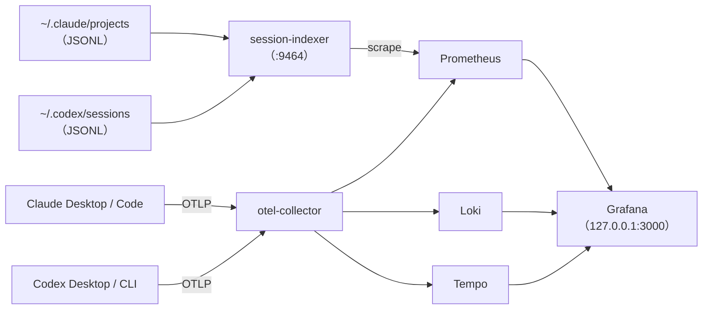

# agent-telemetry 📊

**Claude Code / Claude Desktop** と **Codex CLI / Codex Desktop** の利用状況を、1つの Grafana でローカルに観測するための構成です。

データの取り込み経路を2本用意しているので、片方に欠けがあってももう片方で補えます。

| 経路 | 取得元 | 得られるもの | Desktop アプリ |
|---|---|---|---|
| OTLP | 各アプリに組み込みの OpenTelemetry 出力 | コスト、トークン、API レイテンシ、ツールのイベント、トレース | 対応。`~/.claude/settings.json` と `~/.codex/config.toml` で設定する（Desktop アプリは `~/.zshrc` を読まないため） |
| 会話記録（Transcript） | `~/.claude/projects/**/*.jsonl` と `~/.codex/sessions/**/*.jsonl` | セッションごとの所要時間、トークン数、キャッシュ率、ツール呼び出し数と失敗数、同じコマンドの反復回数、失敗後の再実行回数 | 対応。どちらのアプリもこのファイルを書き出す |



会話記録は **集計した数値だけを送り、中身はどこにも送りません**。ソースコード、プロンプト、シークレットはディスク上に残ったままです。

## 🚀 使い方

```bash
mise run setup
cp .env.example .env            # GF_SECURITY_ADMIN_PASSWORD を設定する
mise run up                     # docker compose up -d --build
mise run client:check           # Desktop と CLI の設定変更内容を確認（ドライラン、ファイルは変更しない）
mise run client:apply           # 設定を書き込む（バックアップを自動で作成）
# Claude Desktop と Codex Desktop を完全に終了してから、起動し直す
open http://127.0.0.1:3000      # 「Agent Telemetry」フォルダにダッシュボードがある
```

Docker を使わない場合は `mise run report` を実行してください。会話記録を直接読んで、セッションごとの集計表を出力します。

## ✅ 実際にデータが届いているか確認する（最初に1回）

Desktop アプリは CLI より送るデータの種類が少ない可能性があります。思い込まずに確認してください。

1. `.env` で `DEBUG_VERBOSITY=detailed` に設定し、`docker compose up -d otel-collector` を実行する。
2. `mise run verify` を実行した状態で、各 Desktop アプリで小さなタスクを1つずつ実行する。
3. アプリごとに、メトリクス・ログ・トレースのどれが届いたかを記録する。終わったら `basic` に戻し、もう一度 `docker compose up -d otel-collector` を実行する（実行中のコンテナは古い値のまま動き続けるため）。

OTLP 経路で届かないデータがあっても、**Agent Sessions** ダッシュボード（会話記録の経路）で補えます。

## 📈 ダッシュボード

| ダッシュボード | 取得元 |
|---|---|
| Agent Sessions（Claude + Codex） | session-indexer（今回新規に作成） |
| Claude Code / Codex CLI / Comparison / Overview | OTLP（llm-cli-telemetry から流用） |

## 📏 session-indexer が出すメトリクス

すべてのゲージに `tool`、`session_id`、`project` のラベルが付きます。`project` は、Codex で git 情報からリポジトリ名が分かればその名前、それ以外は作業ディレクトリ（cwd）の末尾の名前です。Claude のワークツリー（`<repo>/.claude/worktrees/<名前>`）は `<repo>` にまとめます。

- **active_seconds**：イベント間の時間を合計したもの。ただし `IDLE_GAP_SECONDS`（既定 300 秒）を超える間隔は放置時間とみなして除外します。開始から終了までの時間（wall）は放置時間を含むので、対話型のセッションでは実態とずれます。
- **retries_after_failure**：直前の実行が失敗したコマンドを、同じ内容でもう一度実行した回数。**ループに陥っていることを示す最重要シグナル**です。
- **Codex の input_tokens**：キャッシュ分を除いた値です。OpenAI はキャッシュ分を input に含めて報告するため、ここでは分離して Claude と比較できる形にしています。
- **Codex のサブエージェント**：`parent_thread_id` を持つスレッドは親セッションに合算します（Claude のサブエージェントと同じ扱い）。中身のない空のサブエージェントファイルは除外します。
- **Codex Desktop の tool_calls**：Desktop はツールを `exec` / `js` で包んで呼ぶため、包みの呼び出しではなく、`item_completed` として記録される実際の実行（コマンド、MCP 呼び出し、ファイル変更）を数えます。

会話記録のファイル形式は公開仕様がありません。アプリの更新後に数値がおかしくなったら、次のコマンドで構造を確認してください。キー名と型だけを表示し、中身は表示しません。

```bash
uv run --project session-indexer session-indexer schema ~/.codex/sessions/2026/10/29/rollout-....jsonl
```

## 🚧 まだ含まれていないもの

- **PR がマージされたか**：GitHub API と、どのセッションがどの PR を作ったかの紐づけが必要です。別のコレクターとして追加する予定です。
- **Claude と Codex の会話の紐づけ**：プロンプトやコンテキストで共通の `run_id` を受け渡す仕組みが必要です。追加予定です。

## 🔒 セキュリティ

- すべてのポートを `127.0.0.1` にのみ公開しています。Grafana には初期パスワードがなく、匿名アクセスも無効です。
- 会話記録のディレクトリは読み取り専用でマウントしています。マウント先のコンテナ自体も、読み取り専用・非 root・権限（capability）なしで動かしています。
- Codex は `log_user_prompt = false` にしています。Claude Code は `OTEL_LOG_USER_PROMPTS=1` を設定しない限りプロンプトを伏せて送ります。

## 🙏 クレジット

[Mizune/llm-cli-telemetry](https://github.com/Mizune/llm-cli-telemetry)（MIT、コミット `6d224e8`）をベースにしています。Loki と Tempo の設定、データソース定義、記録ルール、ダッシュボード4種を流用しました。ライセンスは `docs/THIRD_PARTY_LICENSE-llm-cli-telemetry` を参照してください。

## 共通開発ルール

`session-indexer` に dev-standards の `python-uv` プロファイルを適用しています。
作業開始時に `mise run standards:prepare`、終了前に `mise run standards:verify` と
`mise run standards:finish` を実行します。`mise run check` は設定整合性、既存の
Lefthook、Ruff、pytest、パッケージビルドを検査します。
従来のテストと lint をまとめたタスクは `mise run indexer:test` として保持しています。

設定は `.standards/mise.project.toml`、`.standards/tasks.project.toml` と
`.standards/*.local` の正本を編集します。
`./.standards/cache/dev-standards plan --output .standards/plans/update.json` で計画を保存・確認し、
`./.standards/cache/dev-standards apply --plan .standards/plans/update.json` で適用します。
Python を継続採用する理由は `docs/decisions/0001-language.md` に記録しています。
既存の Compose 操作とクライアント設定タスクの名前は維持しています。
既存 CI と生成された Dev Standards workflow は併存します。

ローカルの保守台帳には登録済みですが、今回の導入では定期実行を設定していません。
GitHub から更新を配布するには、dev-standards の Python 対応と利用先の導入変更を
それぞれコミットし、既定ブランチへ統合する必要があります。

Renovate の hook は mise で固定した Node/npx を直接起動し、システムの別版 Node が
異なる ABI の RE2 を読み込むことを防ぎます。RE2 のフォールバックは検査失敗として扱います。
Renovate の固定版は `renovate.json5` の custom manager で引き続き更新対象にしています。

新規 checkout では、Python/uv 対応を含む同じ版の dev-standards CLI をビルド・インストールし、
`dev-standards sync` で Git 管理外の CLI キャッシュを配置してから共通タスクを実行します。
利用先の統合より先に dev-standards 本体の変更を統合してください。
